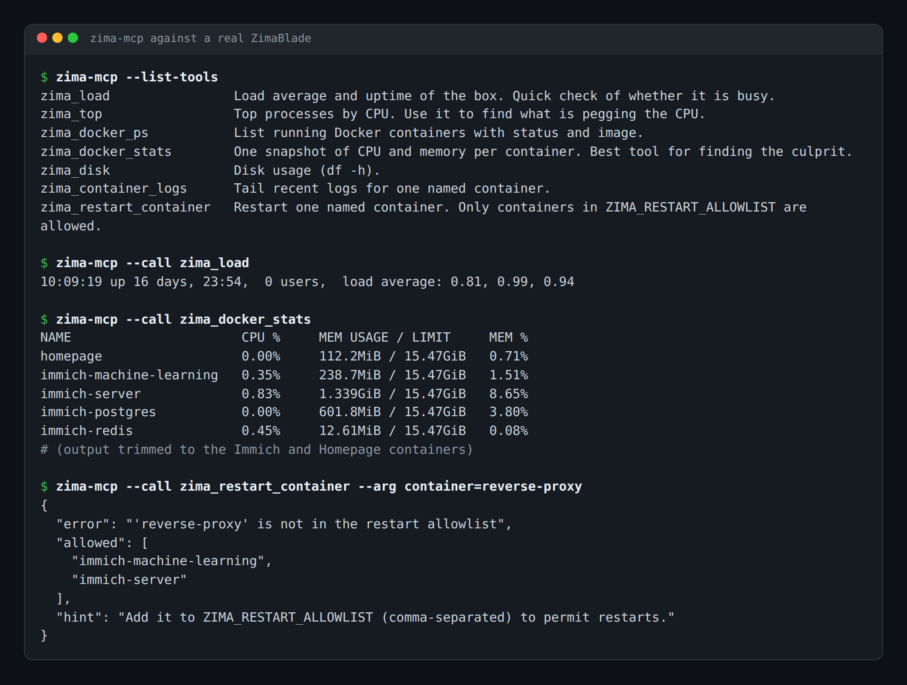
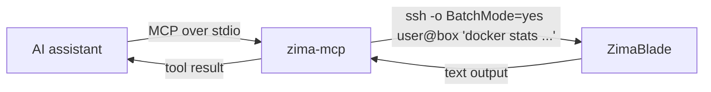

# zima-mcp

An MCP server that lets your AI assistant check on a ZimaBlade (or any Docker box) over plain SSH, and restart the containers you allow, with nothing installed on the box.

<!-- mcp-name: io.github.casareanderson/zima-mcp -->



*Real output from a ZimaBlade running ZimaOS, captured 11 Oct 2026. The stats table is trimmed to the Immich and Homepage containers.*

  [](https://buymeacoffee.com/iamc_tech)

## Contents

- [What it does](#what-it-does)
- [Quick start](#quick-start)
- [Usage](#usage)
- [Configuration](#configuration)
- [How it works](#how-it-works)
- [Status, limits and real results](#status-limits-and-real-results)
- [Licence and credits](#licence-and-credits)

## What it does

- **Answers "is the box busy?"** with load average and uptime (`zima_load`).
- **Finds the culprit** with top processes by CPU (`zima_top`) and one snapshot of CPU and memory per container (`zima_docker_stats`).
- **Lists containers** with status and image (`zima_docker_ps`) and shows disk usage (`zima_disk`).
- **Reads logs** for one named container, up to 500 lines (`zima_container_logs`).
- **Restarts a container**, but only one you have put on the allowlist (`zima_restart_container`). Everything else is refused.
- **Can't reboot the box, use sudo or kill root processes.** None of the tools runs those commands, and the test suite checks that.

## Quick start

You need Python 3.10+, an SSH key that logs in to the box without a password, and a user on the box that can run `docker` without sudo. On ZimaOS the normal user can, because it's in the `docker` group.

```bash
# 1. check SSH and docker work for that user
ssh you@your-zima docker ps

# 2. install
pipx install git+https://github.com/casareanderson/zima-mcp

# 3. try one tool
ZIMA_HOST=your-zima ZIMA_USER=you zima-mcp --call zima_load
```

Success looks like one `uptime` line, for example `10:09:19 up 16 days, 23:54, 0 users, load average: 0.81, 0.99, 0.94`.

Then add it to your MCP client (next section). The full walkthrough, including every client and the common errors, is in [docs/SETUP.md](docs/SETUP.md).

## Usage

**Claude Code:**

```bash
claude mcp add zima -e ZIMA_HOST=your-zima -e ZIMA_USER=you -e ZIMA_RESTART_ALLOWLIST=immich-server -- zima-mcp
```

**Claude Desktop, Cursor and most other clients** take the same JSON shape (`claude_desktop_config.json`, `~/.cursor/mcp.json`):

```json
{
  "mcpServers": {
    "zima": {
      "command": "zima-mcp",
      "env": {
        "ZIMA_HOST": "your-zima",
        "ZIMA_USER": "you",
        "ZIMA_RESTART_ALLOWLIST": "immich-server,immich-machine-learning"
      }
    }
  }
}
```

Then ask things like "is the Zima busy?", "which container is eating the memory?" or "show me the last 100 lines of immich-server's logs".

**Testing without a client:**

```bash
zima-mcp --list-tools
zima-mcp --call zima_docker_stats
zima-mcp --call zima_container_logs --arg container=immich-server --arg lines=50
```

## Configuration

All settings are environment variables. There's a copy-and-edit template in [config.example.env](config.example.env).

| Variable | Default | What it does |
|---|---|---|
| `ZIMA_HOST` | required | Hostname or IP of the box |
| `ZIMA_USER` | required | SSH user. Must be able to run `docker` without sudo |
| `ZIMA_SSH_PORT` | `22` | SSH port |
| `ZIMA_SSH_KEY` | your SSH default | Path to a private key, passed as `ssh -i` |
| `ZIMA_SSH_TIMEOUT` | `20` | Seconds before a command is given up on (60 for restarts) |
| `ZIMA_RESTART_ALLOWLIST` | empty | Comma-separated container names the agent may restart. Empty means every restart is refused |

## How it works



Each tool is one fixed command run with `ssh`. SSH runs in `BatchMode`, so it never sits waiting for a password. A command that takes too long is stopped and reported as an error, not left hanging. Container names are checked against Docker's own naming rules before they go anywhere near a shell, so a name like `--help` or `a;reboot` is refused, and names are shell-quoted as well. Restarts also have to be on the allowlist.

```
zima_mcp/
  server.py      the tools, SSH runner, config and MCP wiring
  __main__.py    python -m zima_mcp
tests/
  test_server.py unit tests plus an in-memory MCP session
scripts/
  setup-check.sh what CI runs to prove docs/SETUP.md works
```

## Status, limits and real results

- **Status:** in use on one ZimaBlade (ZimaOS) as the "Zima ops" toolset of a self-hosted agent. This repo is the cleaned-up, configurable copy. The output above is from that box on 11 Oct 2026.
- **Tested:** 19 unit tests, plus a CI job that follows [docs/SETUP.md](docs/SETUP.md) against a stand-in Docker host on the GitHub runner (SSH to localhost, a real `nginx` container, a real allowlisted restart).
- **Not a ZimaOS API client.** It doesn't talk to the ZimaOS/CasaOS app store or settings, only to `docker` and standard Linux tools over SSH. That's also why it works on any Linux Docker host.
- **One box per server.** To watch two boxes, add it twice under different names.
- **`zima_top` uses `top -o %CPU`.** That works on ZimaOS. Some minimal BusyBox systems don't support `-o`, and the tool will return the error text.
- **Can't fix a sick host.** No reboot, no sudo. If the box itself is wedged, it tells you and that's all.

## Licence and credits

MIT, see [LICENSE](LICENSE). Built on the [Model Context Protocol Python SDK](https://github.com/modelcontextprotocol/python-sdk) (MIT).

If zima-mcp is useful to you, [buy me a coffee](https://buymeacoffee.com/iamc_tech). More field notes at [dev.to/iam-tech](https://dev.to/iam-tech).
